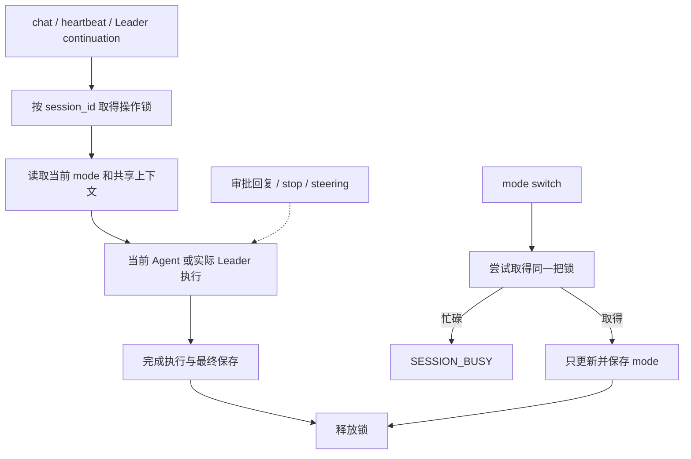
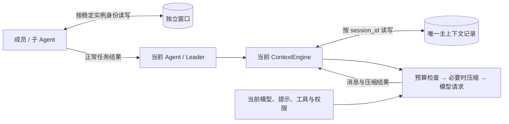

# Session 共享主对话窗口

## 1. 设计定位与依据

同一 Session 在 Agent 与 Team 模式之间切换时，当前 Agent 或实际 Leader 应继续读写同一份上下文；Team 成员和子 Agent 各有独立窗口。模式决定执行者及模型配置，不决定主上下文的身份。

本次修订将目标限定为：

1. 主上下文按唯一 `session_id` 存储和修改，只有一个权威来源；成员窗口独立。
2. 运行与模式切换共用同一把 Session 操作锁。
3. 每次模型请求前，按当前模型的上下文预算检查并触发现有压缩器；压缩结果写回同一窗口。

本文是目标设计，不代表当前工作区已全部实现或验证。当前契约及实施依据见 Swarm 的
[S_01_agent-leader-context-handoff](../../../specs/runtime/S_01_agent-leader-context-handoff.md)、
[S_02_session-operation-ownership](../../../specs/runtime/S_02_session-operation-ownership.md)，以及同级 agent-core 的
`.agents/agent-docs/specs/core_runtime/S_02_session-conversation-store.md`。

本方案替代 [D-20261028-1704-agent-leader-context-handoff](../../active/D-20261028-1704-agent-leader-context-handoff/design.md)
的消息复制、owner 转移、pending journal 和 receipt。旧方案的实现（Swarm `8f7d09bef`、core `82b2b4efc`）未进入两仓 develop，
没有已发布的 Session 依赖其状态，因此不作为兼容路径保留，随本方案直接移除；主路径只保留一套对话权威和一把 Session 操作锁。
缺少共享记录的旧 Session 沿用改造前的行为，不经过旧 handoff。

## 2. 核心不变量

| 编号 | 约束 |
| --- | --- |
| C-1 | 当前授权存储命名空间内，主上下文只由 `session_id` 标识，不含 mode、profile 或 agent card ID。 |
| C-2 | 当前 Agent 与实际 Leader 访问同一记录；成员和子 Agent 使用稳定实例身份对应的私有窗口，只通过正常结果路径向父窗口传递内容。 |
| C-3 | 运行取得 Session 锁之后，才以持锁读到的 mode 确定运行类型与执行者，并读取 context；锁一直持有到执行、压缩和最终保存结束。模式切换取得同一把锁后只更新 mode。 |
| C-4 | 审批回复、stop 和 steering 交给当前持锁运行，不重新申请该锁；失败和取消也必须完成收尾并释放所有权。 |
| C-5 | 每次请求使用当前模型预算检查窗口，必要时压缩并保存；旧缓存、执行者 checkpoint 和 UI history 不得覆盖或展开共享窗口。 |

适用于原生 Agent/Team 的 work/code、normal/plan 模式。切换保留项目绑定与工作目录；系统提示、工具、权限和模型设置仍属于当前执行者。

## 3. 总体架构

### 3.1 命令流

普通输入沿用既有排队策略。审批回复、stop、steering 以及发给运行中 Leader 的输入必须加入当前运行而不是等锁，所以请求在取锁前仍要先被识别；这次识别只用来找到可加入的运行或排队位置，不作为最终依据。运行取得所有权后按持锁读到的 mode 确认运行类型（单 Agent 或 Team）并选择执行者；与取锁前的识别不一致时，在启动执行者、产生任何输出之前放弃本次尝试，按已提交的 mode 重新分派。重新分派只是兜底：模式切换仍保留“已有运行到达”的 busy 检查（见下），因此正常情况下不会在等待期间遇到切换。执行者每次接收输入时的 mode 复核收敛为 Leader 自行取得所有权（后台续跑）时确认一次。两种先后顺序的结果固定：运行在先、模式切换在后，切换立即以 `SESSION_BUSY` 被拒绝，由用户稍后重试，不会等运行结束后自动执行原切换请求；模式切换在先、运行在后，运行排队等待切换完成后按新 mode 启动，不因切换而失败，也不要求用户重试，等待期间无论切换多少次都如此。

“运行在先”从运行到达服务端起算，而不是从它取得操作锁起算：请求已被服务端接收或已进入 Runtime 队列但尚未开始执行时（例如启动较慢），模式切换同样被拒绝，该运行按发送时的 mode 执行，用户不会因为“以为只影响下一次运行”而改变已发出的请求。该判断在切换取得操作锁的时点取样，取得之后才到达的运行不能否决这次切换，而是排队等待新 mode。这里的“到达”是服务端接收时间，不是用户按键时间；系统不使用客户端时间戳。后台主窗口写入同样归属某次持锁运行；纯观察流和缓存对象不持锁。

### 3.2 数据流

ContextEngine 可以保留运行中的内存缓冲和模型相关缓存，但共享记录是唯一持久化对话权威。执行者的 task、goal、交互、turn 计数及 Team 状态仍保存在原 checkpoint，不与其他执行者共享。

## 4. 详细设计

### 4.1 数据身份与存储

主窗口对宿主的定位方式是 `session_id`。通用存储内部可以使用 `(session_id, main)`，其中 `main` 是固定槽位，不是需要独立分配、迁移或切换的第二个主对话身份。现有 `ConversationKey` / binding 可作为内部适配，无需为简化术语重新实现或删除公共 API。

私有窗口的 key 由已有标识确定性派生，不另存身份映射：Team 成员使用 team 与成员注册名，子 Agent 使用已持久化的实例 ID，嵌套子执行者还包含父窗口身份，不能与父窗口串写。显示名称和模板 card 不承担身份隔离。同一 Session 内成员被移除后以相同注册名重建，沿用原私有窗口。

记录保留结构化 `messages`、必要的 offload 引用/数据及格式版本；摘要直接采用现有消息表示，不另设一份独立 summary 权威。复用现有存储 provider 和 codec，不增加数据库配置链路。

保留 create/read/commit 三个职责即可：只在新 Session 的创建边界幂等创建空记录（单一入口），运行取得锁后读取，修改后通过统一通道保存。缺失记录与读取失败必须可区分，不自动以空窗口或旧 history 回填。store 不再取得宿主操作锁，也不引入窗口 CAS、epoch 或交接事务。

### 4.2 上下文装载与写入

宿主为主 Agent 与实际 Leader 提供同一个主窗口绑定，为成员提供私有绑定。运行取得锁后先恢复执行者状态，再读取当前窗口；命中执行者缓存也不能跳过刷新。已绑定窗口必须从执行者 checkpoint 的对话保存/恢复路径中排除。

输入只由现有输入路径追加一次。用户消息、assistant 消息、工具结果、压缩和 offload 都走同一上下文写入通道。执行者在一次持锁运行内使用内存工作副本，写回共享记录的时点固定为两处：每次模型请求之前（含本次压缩结果），以及运行结束时的最终保存；不按每条消息写回，无变化时不重写。C-3 规定的最终保存必须完成后才发布成功完成并释放锁。

由此，除已登记的审批中断外，共享记录中每个工具调用都有对应结果，重启后可以直接装载。进程在两次模型请求之间异常退出时，上一次请求之后的 assistant 回复和工具结果不在记录中；已执行的工具可能在后续输入中被模型再次调用，这是本方案接受的代价。

共享的是历史消息，不是执行配置。请求仍使用当前执行者的提示、工具、权限和模型；Team policy/context tracker 沿用现有注入机制，并验证压缩或切换后必要信息仍能获得。

### 4.3 当前模型预算与压缩

每次模型请求前，使用本次调用实际选择的模型及其上下文上限，重新计算完整请求的 token 预算。不能沿用另一模型的 usage 统计或创建缓存时固化的预算。

可用输入预算 = 当前模型上下文上限 − 预留输出 token − 既有安全余量（如配置）。预算检查包含系统提示、工具定义和当前对话消息。触发点就是现有压缩器配置的比例（当前为可用预算的 80%，`trigger_context_ratio`），按当前模型的预算计算；沿用现有 token 计数、压缩触发配置和模型超限后的被动压缩，不新增压缩算法、“贴近上限才压缩”的新逻辑或另一套阈值配置。

请求达到有效预算阈值或下一次发送将超预算时，执行现有压缩器，将结果保存回同一窗口，再检查请求是否可发送。若不可压缩的提示/工具等仍使请求超限，应明确失败，不循环压缩或发送已知超限的请求。模型上限缺失时沿用明确的配置/解析策略，不能静默借用上一模型的上限。

切换到更小模型后，在它的首次请求前执行上述检查；mode switch 本身无需读写或压缩消息。切回更大模型保留已有摘要，不从旧 checkpoint 或 UI history 展开原文。成员私有窗口也按各自当前模型的预算处理。

### 4.4 运行与模式切换的操作锁

复用已有 Session 串行 lane 和操作锁组件，避免另建锁服务。lane 负责排队，操作锁负责运行与模式切换互斥；既有短时 metadata/provider 锁仍只保护自己的读写，不替代 C-3 的整次运行边界。

锁的所有权归运行，不归前端响应流。等待工具、交互回复和取消收尾时仍持有；前端断开、round 事件发出或后台任务尚在保存，都不是提前释放的依据。私有成员写自己的窗口不取得主 Session 锁；成员结果由当前运行消费，或排队成为后续输入。

取得锁后再确定运行类型和当前执行者（见 §3.1）；mode switch 保存 mode 后释放锁，不复制历史、不恢复目标执行者、不启动模型。无操作或未被接纳的命令不能遗留锁引用。

### 4.5 中断、取消与保存失败

工具等待审批时，未闭合调用是合法的执行中状态。原执行者依据已登记的交互状态恢复，继续补齐工具结果；不能把“另一模式接管稳定窗口”的完整性检查无条件用于原运行的中断恢复。

取消、暂停或回滚若改变上下文，必须保存最终选定的窗口和必要执行状态后，才能确认对应边界；不能内存已回滚而持久化记录仍保留另一版本。错误路径沿用现有恢复机制，不能自动重放已产生外部副作用的工具。共享窗口上的 Leader 某一轮执行异常时，该轮报告失败后回到空闲，不自动重放输入，Leader 保持存活，用户的下一条输入开启新一轮；保存失败仍按下文明确传播，不属于这一情形。

输入保存失败时不启动后续模型调用；最终保存失败时不宣告成功。提交确认丢失时明确传播失败/未知状态，后续从存储核实，不从旧缓存盲目补写。本文不新增跨记录事务或 exactly-once 系统。

Offload 引用必须在切换执行者或重启后仍可访问，复用对话级存储或现有 provider；不能依赖已回收执行者的私有文件/内存。不可访问的引用明确失败，不隐式迁移私有文件。

## 5. 实施单元与收尾

保留原 I-00～I-07 标识供已有实施记录引用。下表是收敛后的职责，不重写先前实施结果；I-00 统一负责锁边界，I-04 只负责宿主存储装配。

| 项目 | 收敛后的职责 |
| --- | --- |
| I-00 | 运行与 mode switch 共用操作锁，覆盖正常、后台、交互、取消和最终保存边界；该锁独立于归档/删除既有的执行锁，不新增生命周期状态机，不改变归档/删除行为。 |
| I-01 | 定义/复用对话 store 与内部绑定，主记录由 Session ID 定位；隔离执行者 checkpoint 中的对话数据。 |
| I-02 | ContextEngine 统一读写、缓存刷新、offload 与压缩；每次请求使用当前模型预算。 |
| I-03 | 主 Agent/实际 Leader 使用同一绑定，成员/子 Agent 使用私有绑定；接通中断恢复及全部执行收尾保存。 |
| I-04 | Swarm Service/Manager/adapters 注入上述绑定，接入 I-00 已有操作边界；不再单独实现一套锁。 |
| I-05 | 改接已有恢复/warmup 及 fork/rewind 消费者，避免旧 context/history 覆盖新记录；具体兼容边界见 §6。删除/归档对共享记录的处理不在本单元内，预留给后续开发。 |
| I-06 | 直接移除未发布的旧 handoff：Swarm 复制、owner 转移、pending journal、receipt 及其独立锁和 warmup/adapter 分支；core 中仅由旧 handoff 消费的导出与 idle 查询一并移除。保留共享路径复用的快照校验器、admission guard、Leader 启动前预备钩子与 `NativeHarness.prepare`；操作锁绑定不能随旧入口一同丢失。 |
| I-07 | 同步两仓契约与用户说明，使用匹配 core 发布版本更新依赖；不把本地源码验证当成发布依赖验收。 |

I-00 可独立实施；存储链按 I-01 → I-02 → I-03/I-04 推进。I-06 的旧路径移除不依赖 I-05，与 I-04 同步完成；随后完成 I-05 的消费者改接，再做 I-07。验收以真实装配入口为准，不能只替换测试 fake。

## 6. 兼容边界与范围外工作

删除与归档不在本设计范围内（见 §9，2026-11-14）。两者保持现有实现和行为：使用自己的执行锁、持久化 fence 和后台 finalizer，可以受理运行中的 Session 并自行停止运行。本设计的操作锁不与它们共用锁文件，不改变它们的受理、排他或事件通知。

为后续开发预留、目前未实现的位置：删除/归档加入运行与模式切换的同一把操作锁（锁接口保留资源类型参数）；排队运行取得所有权后的 lifecycle fence 复核；删除 Session 时清理其共享对话记录（当前删除后主记录和成员窗口记录仍留在存储中）；归档/恢复对共享记录的处理。

此前 PR #10243 的分析仅作历史依据，详见 §9。

已有 fork/rewind 等消费者（包括 core develop 新增的专家 fork：从成员实时上下文或已完成 turn 继承窗口）不能继续改写执行者私有 context 或从 UI history 重建新窗口。专家 fork 适配为：新成员的私有窗口创建时，一次性写入来源窗口的内容作为起点，此后两个窗口互不关联。其他消费者能沿用既有语义的，定向接到统一存储；尚未适配的，对新格式 Session 明确拒绝。新的回退定位算法、offload 引用计数和分叉功能扩展另行设计。

旧 Session 历史迁移不在本次范围，验收使用新建 Session；不清理存量日志或 checkpoint，也不把缺少新记录的旧 Session 静默当作空会话。缺少共享记录的旧 Session 保持改造前的行为（Agent 与 Team 各用各的上下文），不创建共享记录，也不从 history 导入。外部 CLI、team.design、多个服务进程共同推进同一 Session 不在本次范围。

## 7. 验证计划

以下是预期验收条件，不代表已经执行。保留原 V 编号，相关场景合并验收；生命周期专属场景不重复在此建设。

| 原编号 | 场景与通过条件 |
| --- | --- |
| V-01 / V-02 / V-06 | Agent 写入 A，实际 Leader 写入 B/D，再切回缓存 Agent；实际模型请求包含共同历史，八种原生模式的主记录身份不变，旧缓存不覆盖。 |
| V-03 | 成员与嵌套子 Agent 私有窗口写入 X，只返回 Y；主窗口仅通过正常结果路径收到 Y，私有窗口重建后仍隔离。 |
| V-04 / V-05 / V-13 | 在模型、工具、压缩、后台 producer 和最终保存处设置屏障；mode switch 始终取锁失败。运行结束后可切换，排队输入使用切换后的 mode；观察流、无操作命令不遗留锁。 |
| V-07 | 同一历史在大模型预算内不因旧小模型缓存而误压缩；切到小模型首次请求前触发压缩，完整请求符合当前预算；切回大模型不展开原文。成员窗口按各自模型验证。 |
| V-08 / V-11 | 重启或重建执行者后仍读取共同记录，保留当前执行配置及必要 Team 信息，输入不重复追加。 |
| V-09 / V-14 | 真实工具审批后可恢复；取消/回滚后的内存与持久化结果一致；输入保存失败不调用模型，最终保存失败不发布成功，不重放工具。各路径收尾后可再次取锁。进程在工具执行中途退出后，记录停在上一次模型请求之前且可正常装载；Leader 某轮异常后保持空闲可用、输入不重放。 |
| V-10 | 结构化工具消息与 offload 在切换/重启后可读取，工具配对正确；不可访问引用明确失败。 |
| V-12 | 专家 fork 的新成员窗口以来源内容为起点且之后互不影响；删除/归档对新记录的处理已移出范围（§6）；rewind 等其余消费者要么正确适配，要么明确拒绝，不能串写或恢复旧影子数据。 |
| V-15～V-17 | 属于原先扩展的生命周期加固验收，移出本设计新增范围；已有相关回归和现行契约继续保留。 |

模型预算与消息内容可先用可控模型边界测试验证，但必须经过真实 Agent/Leader、ContextEngine 和存储装配。发布前另核对匹配依赖和实际模型请求；验证证据写入 feature，不回填为设计事实。

## 8. 取舍与开发交接

选择共享记录，避免随模式增长维护复制与交接状态；代价是当前模型的压缩对后续所有主执行者共同生效。选择整次运行共锁，使 mode 不会在运行中改变；控制输入必须保持可达，不能另起竞争操作。

开发应优先核对：当前模型预算是否随模型切换刷新、工具中断恢复是否误用完整窗口校验、取消后的回滚是否最终保存，以及旧 handoff 退出后操作所有权是否仍独立接通。上述是核心契约的接线要求，不新增同步或恢复协议。

## 9. 讨论、确认与设计修订

| 日期 | 确认方 | 内容与结论 |
| --- | --- | --- |
| 2026-11-11 | 用户（本次对话） | 要求同一 Session 的当前 Agent/Leader 读写同一窗口，子 Agent 使用不同窗口；要求运行期间禁止 mode 切换，类似现有删除/归档保护 |
| 2026-11-11 | 用户（澄清回复） | 共享覆盖 work/code、normal/plan；压缩结果共同生效；旧历史无需纳入本次处理，按不承诺迁移解释 |
| 2026-11-11 | 用户（方案简化） | 活动对话、mode switch、delete、archive 使用同一 Session 锁，持有直到操作结束；据此移除窗口 revision/CAS 和独立同步协议，缓存改为持锁后读取最新数据 |
| 2026-11-11 | — | 按用户提供的 PR #10243 核对已有执行锁、短时资源锁、idle-check fence 与后台 finalizer；明确复用现有互斥和恢复，区分当前本地代码与 PR 候选 |
| 2026-11-11 | 用户（实施顺序） | 本方案先于 PR #10243 实施；将必要的统一锁和 archive/delete 服务端保护纳入本次，PR 后续复用，移除其先合入的隐含前置 |
| 2026-11-11 | 用户（架构图要求） | 将总体架构拆成命令流和数据流，明确锁与控制输入路径、后台 lifecycle 接手、主窗口读写和子窗口隔离 |
| 2026-11-11 | — | 新建设计草稿，记录跨仓职责、目标架构、数据契约和验证计划；尚未进行完整方案评审或批准 |
| 2026-11-13 | 用户（检视后决定） | 确认旧 handoff 的两个提交均未进入 develop、无上游依赖；改为直接移除，不保留到 I-06 收尾，缺少共享记录的旧 Session 沿用改造前行为。I-00 已落地的生命周期加固暂保留，仍不作为本设计验收项 |
| 2026-11-13 | 用户（实现澄清） | 压缩沿用现有 80% 比例触发；共享窗口上的 Leader 某轮异常后回到空闲、不重放；写回时点为每次模型请求前和运行结束；成员私有窗口按 team 与注册名派生，同名重建沿用原窗口；取得锁之后才读取 mode；专家 fork 以一次性复制作为新窗口起点；缺少共享记录的旧 Session 保持改造前行为 |
| 2026-11-13 | 用户（锁时序落地方式） | “先取锁再读 mode”无法逐字实现：控制输入和发给运行中 Leader 的输入必须加入当前运行。确认采用“取得所有权后确认运行类型，不一致则在输出前重新分派”；移除模式切换的 busy 检查，已到达但未开始的 chat 按切换后的 mode 运行；mode 复核只在 Leader 新取得所有权时做一次，单 Agent 不再复核 |
| 2026-11-13 | 用户（先后顺序规定） | 运行→模式切换：切换被拒绝并重试；模式切换→运行：运行排队，切换完成后启动，不得失败后让用户重试。据此取消重新分派的次数上限，只在两次确认读到同一 mode（并未发生切换）时才报错 |
| 2026-11-13 | 用户（“在先”的起算点） | 模式切换是会话中的中间操作，用户可能在一次运行迟迟未开始时切换并以为只影响下一次运行；这种情况应返回切换失败。恢复按到达判断的 busy 检查，撤回同日“移除 busy 检查”的决定；重新分派保留为兜底 |
| 2026-11-14 | 用户（范围） | `/delete` 与 `/archive` 功能已存在，但与共享对话无关，不在本方案内处理。移除本分支中全部相关改动（归档/删除受理加固、与运行共锁、lifecycle 复核），两者恢复既有行为；I-05 不再包含它们，§6 列出为后续开发预留的位置。此前 2026-11-11“将 archive/delete 服务端保护纳入本次”的决定据此撤回 |

2026-11-12 修订：用户将目标收敛为统一 Session 上下文、运行与模式切换共锁、按当前模型窗口压缩，并要求修改本文。此前关于 PR #10243 生命周期加固的实施范围由本次 §6 收缩；历史讨论保留作为决策依据，不再作为本设计新增生命周期能力的验收要求。本文仍保留 draft 状态，本次修改不记录整份方案已获正式评审批准。

本次修订只修改设计及生成索引，不修改运行时代码；实际实施、验证结果和遗留继续记录在两仓 feature/spec 中。

2026-11-13 修订：按用户检视后的决定，旧 handoff 由“改接完成后清理”改为随本方案直接移除（§1、§5 I-06、§9）；§6 补充 core develop 新增的专家 fork 属于需适配或拒绝的 fork 消费者。同日按用户对实现方式的澄清，补充 §3.1、§4.1～§4.5、§6、§7 的对应约束，并按锁时序的落地方式修订 C-3、§3.1、§4.4（见 §9 最后两行）。本次修订只修改本文及生成索引，未修改运行时代码。

2026-11-14 修订：按用户决定把删除/归档移出范围并撤回已落地的相关改动（§5 I-00、I-05，§6，§7 V-12，§9）；操作锁改用独立锁文件，使归档/删除保持既有行为。同日此前已完成：写回时点、Leader 轮次异常回到空闲、成员窗口确定性身份、主记录单一建档入口、专家 fork 起点、V-07 验证，见两仓 feature 记录。
